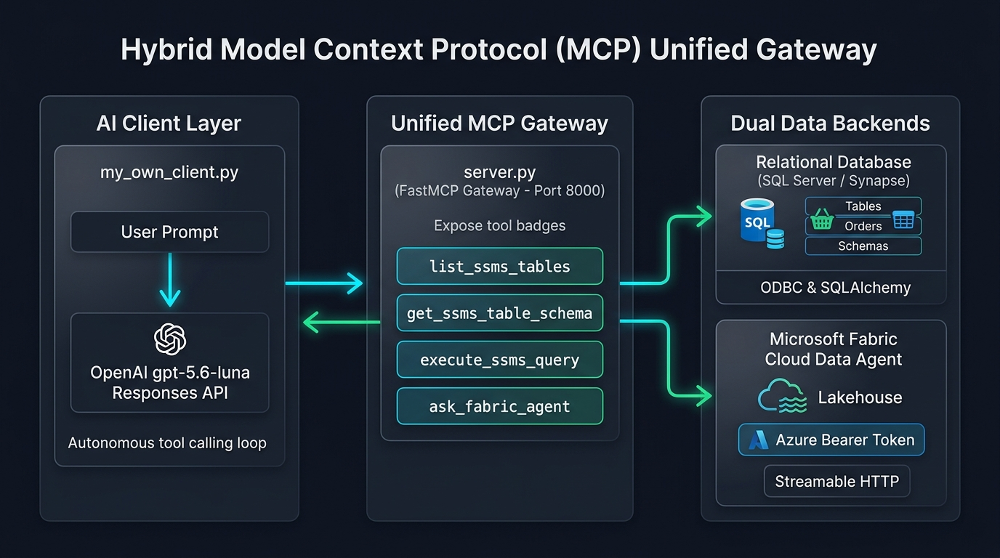
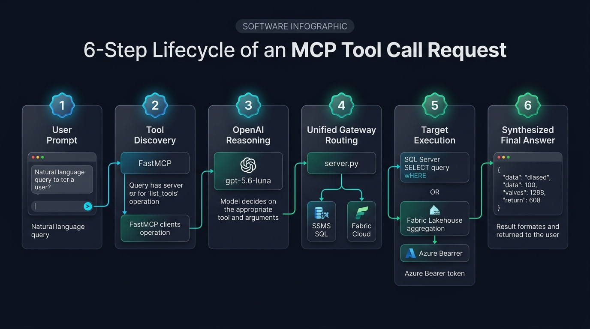

# 📘 Comprehensive Guide: Hybrid MCP Architecture & Troubleshooting
**Project:** Hybrid MCP Architecture (Local SSMS SQL Server + Microsoft Fabric Cloud Data Agent)  
**Approach:** Approach 1 (Unified Gateway Pattern)  
**Author:** Pair Programming Session Summary  
**Date:** October 2026  

---

## 📑 Table of Contents
1. [Overview & Core Architecture (Approach 1)](#1-overview--core-architecture-approach-1)
2. [Why Approach 1? (Advantages & Benefits)](#2-why-approach-1-advantages--benefits)
3. [The 10 MB Event Limit Issue in Fabric Data Agent](#3-the-10-mb-event-limit-issue-in-fabric-data-agent)
4. [Complete Chronological Questions (Hinglish + English)](#4-complete-chronological-questions-hinglish--english)
5. [All Errors Encountered & Permanent Fixes](#5-all-errors-encountered--permanent-fixes)
6. [Whiteboard Interview Cheat Sheet](#6-whiteboard-interview-cheat-sheet)

---

## 1. Overview & Core Architecture (Approach 1)

### 1. High-Level Architecture Poster


### 2. 6-Step MCP Tool Call Lifecycle Poster


### What is the Unified Gateway Pattern?
In Approach 1, instead of having our AI Client connect directly to 5 different databases and cloud agents, we deploy a **single Local MCP Server (`server.py`)** that acts as an intelligent **Unified Gateway**.

```
                           ┌───────────────────────────┐
                           │      my_own_client.py     │
                           │   (OpenAI Responses API)  │
                           └─────────────┬─────────────┘
                                         │
                                         ▼ (Single MCP Connection: http://127.0.0.1:8000/mcp)
                           ┌───────────────────────────┐
                           │         server.py         │
                           │  (Unified FastMCP Server) │
                           └──────┬─────────────┬──────┘
                                  │             │
                ┌─────────────────┘             └──────────────────┐
                ▼                                                  ▼
     [Local Database Tools]                             [Cloud Agent Tool]
     - list_ssms_tables                                 - ask_fabric_agent
     - get_ssms_table_schema                                       │
     - execute_ssms_query                                          │ (StreamableHttpTransport)
                │                                                  ▼
                ▼                                      [Microsoft Fabric Endpoint]
     [Local SSMS / Synapse DB]                         https://api.fabric.microsoft.com/...
```

---

## 2. Why Approach 1? (Advantages & Benefits)

| Feature / Aspect | Approach 1 (Unified Gateway) | Direct Multi-Server Client |
| :--- | :--- | :--- |
| **Client Code Complexity** | **Ultra Light (50 lines):** Client only knows 1 URL (`http://127.0.0.1:8000/mcp`). | **Heavy:** Client must manage authentication, headers, and multiple connection pools. |
| **Token Management** | **Centralized:** Azure Bearer tokens and browser popups are handled inside `fabric_client.py`. | **Scattered:** Frontend client must deal with MSAL, tokens, and expiry. |
| **Hybrid Orchestration** | **Seamless:** LLM gets all tools (SQL + Fabric) in a single discovery call (`list_tools()`). | LLM tools must be manually merged from multiple distinct clients. |
| **Security & Secrets** | **High:** Database passwords and Azure tokens stay on the server gateway. | Client needs access to all secrets and environment variables. |

---

## 3. The 10 MB Event Limit Issue in Fabric Data Agent

### The Problem:
```text
RuntimeError: sent event exceeded a 10 MB limit
```
When querying: *"Top 5 countries by count of certificates active during 2025"*.

### Root Cause:
1. **SSE (Server-Sent Events) Payload Cap:**  
   The Model Context Protocol (FastMCP & Azure API) enforces a **10 MB (10,485,760 bytes)** buffer limit on any individual streamed response event.
2. **Unaggregated Row Dumps:**  
   If the prompt causes the Fabric Data Agent to query raw Lakehouse tables with hundreds of thousands of active certificates without pre-aggregating, the backend attempts to serialize a massive JSON event. Once it crosses 10 MB, the streaming connection drops immediately.

### Best Practice & Solution:
* **MCP is for Insights, Not Bulk ETL:**  
  MCP agents are analytical partners. Large bulk row exports should use OneLake Direct Lake or Synapse pipelines.
* **Enforce Aggregated Prompting:**  
  Instruct the LLM/Agent to summarize and group data at the SQL level:
  ```text
  "Provide ONLY the aggregated total count of active certificates for 2025, 
  grouped by country, top 5 descending. Do NOT return individual certificate records."
  ```

---

## 4. Complete Chronological Questions (Hinglish + English)

### Question 1:
* **Hinglish:** `parent_cwd = os.path.dirname(__file__)` aur `parent_cwd = os.path.dirname(os.path.abspath(__file__))` me kya difference hai?
* **English:** What is the difference between `os.path.dirname(__file__)` and `os.path.dirname(os.path.abspath(__file__))`?
* **Answer:**
  * `__file__` relative path ho sakta hai agar script relative folder se run ho (e.g. `python file.py` returns `"file.py"`, jiska `dirname` empty string `""` ho jata hai).
  * `os.path.abspath(__file__)` pehle poora absolute path banata hai (`D:\Project\...`), jisse `dirname()` hamesha 100% sahi folder path return karta hai chahe terminal kahin bhi open ho.

---

### Question 2:
* **Hinglish:** `db_connection.py` me itna kuch kyu likha hai? Seedhi-seedhi connection string kyu nahi banayi?
* **English:** Why is `db_connection.py` structured with so much code instead of writing a plain connection string?
* **Answer:**
  * SQL Server / SSMS me instances ke naam me backslashes hote hain (`RASHI-VINEET\SQLEXPRESS`), driver names me spaces hote hain (`ODBC Driver 17 for SQL Server`), aur Windows authentication me passwords nahi hote.
  * SQLAlchemy ka `URL.create()` in saare special characters ko automatically safely encode karta hai, jisse connection string kabhi break nahi hoti.

---

### Question 3:
* **Hinglish:** Client me async code pass kyu nahi ho raha tha? Code loop ke andar jaa hi nahi raha tha.
* **English:** Why was the async workflow not executing in `my_own_client.py`?
* **Answer:**
  * Code me outer `async def main(query: str):` ke andar loop me ek aur duplicate `async def main(user_query: str):` define kar diya gaya tha! Inner function sirf define ho raha tha, call nahi ho raha tha (Shadowing Bug). Usko flatten karke resolve kiya gaya.

---

### Question 4:
* **Hinglish:** MCP tool call ka `result` kaisa hota hai? Uske attributes kaun-kaun se hote hain?
* **English:** What does an MCP `CallToolResult` object look like, and what attributes does it expose?
* **Answer:**
  * FastMCP ka result ek `CallToolResult` object hota hai jisme:
    * `result.is_error`: Boolean (True if error occurred).
    * `result.content`: List of blocks (`[TextContent(type='text', text='...')]`).
    * Data extract karne ke liye: `result.content[0].text`.

---

### Question 5:
* **Hinglish:** `target_tool = tools[0]` aur `props` (input schema properties) kyu likha gaya tha? Aasan tareeka kya hai?
* **English:** Why was dynamic schema extraction (`tools[0].input_schema['properties']`) written in `fabric_client.py`? What is the simpler way?
* **Answer:**
  * Official docs generic code likhte hain taaki tool ka parameter chahe jo bhi ho (`query`, `question`, `user_question`), wo dynamic dhoond le.
  * Asal application me agar hume pata hai ki Fabric `user_question` expect karta hai, toh hum seedha likhte hain:
    ```python
    await client.call_tool("fabric_tool_name", {"user_question": question})
    ```

---

### Question 6:
* **Hinglish:** Debugger se run karte waqt `Client(transport error)` kyu de deta hai?
* **English:** Why does running under the VS Code debugger raise a `Client(transport error)`?
* **Answer:**
  1. **Raised Exceptions Breakpoint:** VS Code ke Breakpoints panel me agar `Raised Exceptions` ticked hai, toh library ke internal connection probes par debugger pause ho jata hai.
  2. **Async Timeout / Interactive Login:** Debugger async event loop ko slow kar deta hai, jisse Fabric ka streaming handshake timeout ho jata hai.

---

### Question 7:
* **Hinglish:** `my_own_client.py` me Fabric ka MCP URL toh likha hi nahi hai, toh yeh Fabric ko kaise call karega?
* **English:** `my_own_client.py` does not contain the Fabric MCP URL, so how does it connect to Fabric?
* **Answer:**
  * Gateway Pattern: `my_own_client.py` local server (`http://127.0.0.1:8000/mcp`) se connect karta hai.
  * Server ke paas `ask_fabric_agent` tool registered hai jo background me `fabric_client.py` ko bulata hai, aur `fabric_client.py` Fabric ke actual cloud URL ko call karta hai.

---

## 5. All Errors Encountered & Permanent Fixes

```text
+-------------------------------------------------------------------------------+
| ERROR 1: ModuleNotFoundError: No module named 'pyodbc' / httpcore2 import     |
+-------------------------------------------------------------------------------+
Cause:   Accidental import statement at top of db_connection.py.
Fix:     Removed line `from httpcore2 import __name` and ran with .venv Python.

+-------------------------------------------------------------------------------+
| ERROR 2: TypeError: 'LazyLocalNamespace' object does not support item assign  |
+-------------------------------------------------------------------------------+
Cause:   Python 3.14 PEP 667 incompatibility with VS Code debugpy.
Fix:     Run files directly in terminal via `py script.py`.

+-------------------------------------------------------------------------------+
| ERROR 3: TypeError: int() argument must be a string, not 'dict'               |
+-------------------------------------------------------------------------------+
Cause:   Passing an entire dictionary directly into `fastmcp.Client(dict)`.
Fix:     Pass the string URL: `Client(server_info["url"])`.

+-------------------------------------------------------------------------------+
| ERROR 4: MCPError: User question must be provided.                            |
+-------------------------------------------------------------------------------+
Cause:   Fabric Data Agent tool requires parameter named `user_question`, not `question`.
Fix:     Pass arguments as `{"user_question": question}`.

+-------------------------------------------------------------------------------+
| ERROR 5: Database Error 40532: Cannot open server "kiwaaadmin.com"            |
+-------------------------------------------------------------------------------+
Cause:   SQL username without full server domain prefix on Azure Synapse server.
Fix:     Ensure credentials match Synapse format or switch to local SSMS in .env.

+-------------------------------------------------------------------------------+
| ERROR 6: RuntimeError: sent event exceeded a 10 MB limit                      |
+-------------------------------------------------------------------------------+
Cause:   Querying raw Lakehouse tables with thousands of records over MCP SSE.
Fix:     Ask for aggregated metrics (COUNT, GROUP BY, TOP 5) rather than raw dumps.
+-------------------------------------------------------------------------------+
```

---

## 6. Whiteboard Interview Cheat Sheet

Agar interviewer bole: *"Whiteboard par Python me MCP Client likh ke dikhao"*

```python
import asyncio
from fastmcp import Client

async def run_mcp_client():
    # 1. Connect
    async with Client("http://127.0.0.1:8000/mcp") as client:
        
        # 2. Discover Tools
        tools = await client.list_tools()
        
        # 3. Execute Tool
        result = await client.call_tool("list_ssms_tables", {})
        
        # 4. Extract Output
        print(result.content[0].text)

asyncio.run(run_mcp_client())
```
*Sirf yeh 4 lines hain — koi complex properties ya defensive code nahi!*
