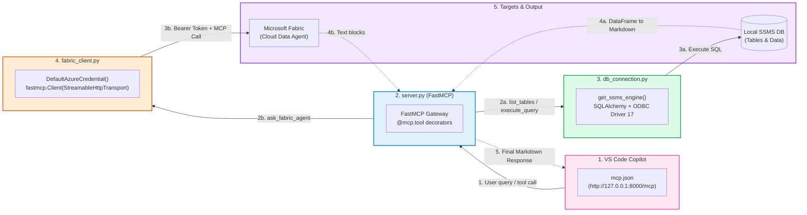
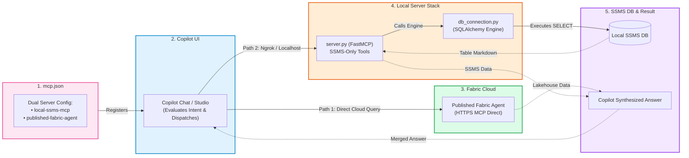

# Hybrid MCP Architecture: Educational Cheat-Sheet & System Flow

This guide provides the **exact infographic cheat-sheet posters** (designed in the style of your reference sample) along with the complete **left-to-right code call sequences, exact code blocks, and folder structures** for both approaches.

---

## 1. Approach 1: Unified Gateway Architecture

In this approach, **`server.py`** is the master unified gateway. The client talks only to this single Python server, which internally connects to both local SQL Server (SSMS) and Microsoft Fabric Data Agent.

### Infographic Poster (Cheat-Sheet Layout)


### Architecture Whiteboard Diagram


### Left-to-Right Step-by-Step Code Flow



### Exact Code Breakdown (Panel by Panel)

````carousel
```json
// Panel 1: .vscode/mcp.json (Client Configuration)
{
  "servers": {
    "unified-ssms-fabric-gateway": {
      "type": "http",
      "url": "http://127.0.0.1:8000/mcp"
    }
  }
}
```
<!-- slide -->
```python
# Panel 2: server.py (Unified FastMCP Server)
from fastmcp import FastMCP
from db_connection import get_ssms_engine
from fabric_client import query_fabric_via_fastmcp_client

mcp = FastMCP("Unified-SSMS-and-Fabric-Server")
engine = get_ssms_engine()

@mcp.tool()
def list_ssms_tables() -> str:
    """Lists local tables from SSMS."""
    ...

@mcp.tool()
async def ask_fabric_agent(question: str) -> str:
    """Queries published Microsoft Fabric Data Agent."""
    return await query_fabric_via_fastmcp_client(question)

if __name__ == "__main__":
    mcp.run(transport="streamable-http", host="127.0.0.1", port=8000, path="/mcp")
```
<!-- slide -->
```python
# Panel 3: db_connection.py (Local SSMS Connector)
import os, urllib.parse
from sqlalchemy import create_engine
from dotenv import load_dotenv

load_dotenv()

def get_ssms_engine():
    server = os.getenv("SQL_SERVER_NAME", "localhost")
    database = os.getenv("SQL_DATABASE_NAME", "master")
    driver = "{ODBC Driver 17 for SQL Server}"
    conn_str = f"DRIVER={driver};SERVER={server};DATABASE={database};Trusted_Connection=yes;"
    params = urllib.parse.quote_plus(conn_str)
    return create_engine(f"mssql+pyodbc:///?odbc_connect={params}")
```
<!-- slide -->
```python
# Panel 4: fabric_client.py (Cloud MCP Client)
from azure.identity import DefaultAzureCredential
from fastmcp import Client
from fastmcp.client.transports import StreamableHttpTransport

credential = DefaultAzureCredential()

def get_fabric_headers():
    token = credential.get_token("https://api.fabric.microsoft.com/.default")
    return {"Authorization": f"Bearer {token.token}"}

async def query_fabric_via_fastmcp_client(question: str) -> str:
    mcp_url = f"https://api.fabric.microsoft.com/v1/mcp/workspaces/{WORKSPACE_ID}/dataagents/{DATA_AGENT_ID}/agent"
    transport = StreamableHttpTransport(url=mcp_url, headers=get_fabric_headers())
    async with Client(transport) as client:
        tools = await client.list_tools()
        result = await client.call_tool(tools[0].name, {"question": question})
        return "\n".join([b.text for b in result.content if b.type == "text"])
```
<!-- slide -->
```text
# Panel 5: Folder Structure & Key Packages
approach_1_unified_gateway/
├── .env.example          # SQL & Fabric credentials
├── .vscode/
│   └── mcp.json          # Points to http://127.0.0.1:8000/mcp
├── db_connection.py      # SQLAlchemy connection engine
├── fabric_client.py      # FastMCP client for Fabric
└── server.py             # Unified entry point server

Key Libraries Used:
- fastmcp               (MCP server and client transport)
- sqlalchemy & pyodbc   (ODBC SQL Server connectivity)
- azure-identity        (DefaultAzureCredential bearer token)
- pandas                (Tabular formatting into Markdown)
```
````

---

## 2. Approach 2: Parallel Copilot UI Architecture

In this approach, **Copilot UI is the master orchestrator**. It directly connects to the **Published Fabric Agent** in Microsoft Cloud while calling a lightweight local Python server only for **SSMS** operations.

### Infographic Poster (Cheat-Sheet Layout)


### Architecture Whiteboard Diagram


### Left-to-Right Step-by-Step Code Flow



### Exact Code Breakdown (Panel by Panel)

````carousel
```json
// Panel 1: .vscode/mcp.json (Dual MCP Registration)
{
  "servers": {
    "local-ssms-mcp": {
      "type": "http",
      "url": "http://127.0.0.1:8000/mcp"
    },
    "published-fabric-agent": {
      "type": "http",
      "url": "https://api.fabric.microsoft.com/v1/mcp/workspaces/<WORKSPACE_ID>/dataagents/<AGENT_ID>/agent"
    }
  }
}
```
<!-- slide -->
```python
# Panel 2: server.py (SSMS-Only FastMCP Server)
import pandas as pd
from sqlalchemy import text
from fastmcp import FastMCP
from db_connection import get_ssms_engine

mcp = FastMCP("SSMS-Local-Plugin-For-Copilot-UI")
engine = get_ssms_engine()

@mcp.tool()
def list_ssms_tables() -> str:
    """Lists local SSMS tables for Copilot."""
    query = "SELECT TABLE_SCHEMA, TABLE_NAME FROM INFORMATION_SCHEMA.TABLES WHERE TABLE_TYPE = 'BASE TABLE'"
    with engine.connect() as conn:
        df = pd.read_sql(text(query), conn)
        return df.to_markdown(index=False) if not df.empty else "No tables found."

@mcp.tool()
def execute_ssms_query(sql_query: str) -> str:
    """Runs read-only SELECT query on SSMS."""
    if not sql_query.strip().upper().startswith("SELECT"):
        return "Error: Only SELECT queries are permitted."
    with engine.connect() as conn:
        df = pd.read_sql(text(sql_query), conn)
        return df.to_markdown(index=False)

if __name__ == "__main__":
    mcp.run(transport="streamable-http", host="127.0.0.1", port=8000, path="/mcp")
```
<!-- slide -->
```python
# Panel 3: db_connection.py (SQL Server Connection Engine)
import os, urllib.parse
from sqlalchemy import create_engine
from dotenv import load_dotenv

load_dotenv()

def get_ssms_engine():
    server = os.getenv("SQL_SERVER_NAME", "localhost")
    database = os.getenv("SQL_DATABASE_NAME", "master")
    driver = "{ODBC Driver 17 for SQL Server}"
    conn_str = f"DRIVER={driver};SERVER={server};DATABASE={database};Trusted_Connection=yes;"
    params = urllib.parse.quote_plus(conn_str)
    return create_engine(f"mssql+pyodbc:///?odbc_connect={params}")
```
<!-- slide -->
```text
# Panel 4: Folder Structure
approach_2_parallel_copilot_ui/
├── .env.example          # Local SQL credentials only (no Fabric keys needed)
├── .vscode/
│   └── mcp.json          # Registers both local and cloud endpoints
├── db_connection.py      # SQLAlchemy engine
└── server.py             # SSMS-only FastMCP tool server
```
````

---

## 3. Side-by-Side Comparison

| Feature | Approach 1: Unified Gateway | Approach 2: Parallel Copilot UI |
| :--- | :--- | :--- |
| **Visual Architecture** | 1 Central Gateway Server (`server.py`) | 2 Parallel Endpoints orchestrated by Copilot UI |
| **Number of MCP Configs in Client** | 1 Endpoint | 2 Endpoints |
| **Where Fabric Token is Handled** | Inside [fabric_client.py](file:///d:/Project/mcp-hybrid-architecture/approach_1_unified_gateway/fabric_client.py) (Backend) | In Copilot / Azure SSO (Frontend) |
| **Local Code Complexity** | Higher (Needs `fabric_client.py` + Azure SDK) | Minimal (Only SSMS database tools needed) |
| **Latency for Fabric Queries** | Client $\rightarrow$ Local Gateway $\rightarrow$ Fabric $\rightarrow$ Client | Client $\rightarrow$ Fabric $\rightarrow$ Client (Faster) |
| **Best Presentation Angle** | "Single secure enterprise gateway proxying all data" | "Micro-agent orchestration directly inside Copilot Studio" |
